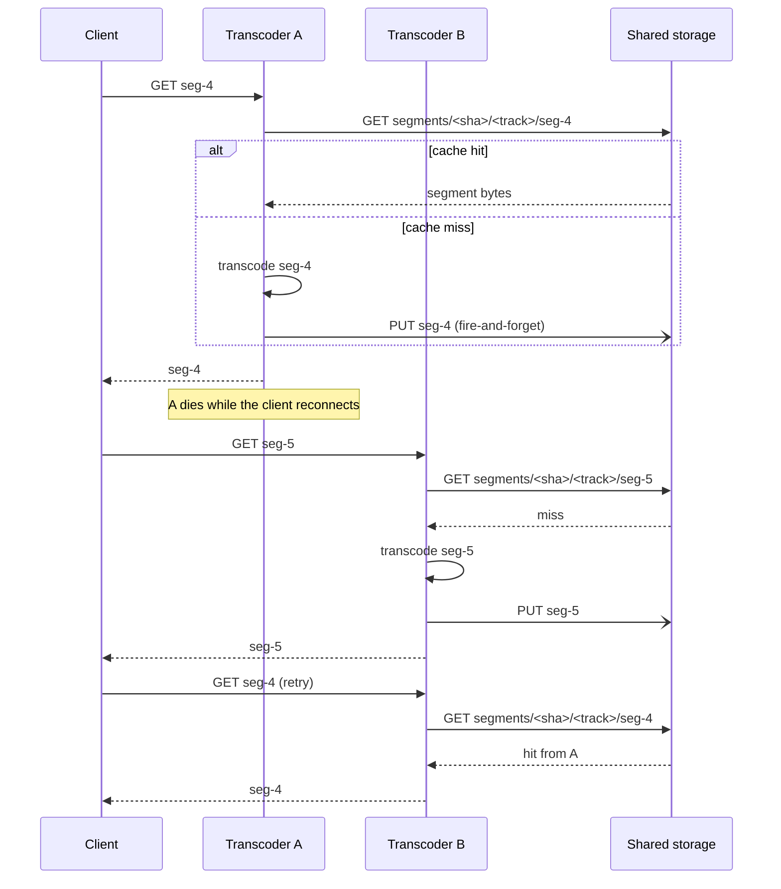

# Shared completed-segment cache: transcoder HA without sticky sessions

Status: proposal. Follows up on
[#914](https://github.com/zoriya/Kyoo/pull/914) (distributed transcoding design
doc), [#1755](https://github.com/zoriya/Kyoo/issues/1755) (horizontal scaling
via S3 blob backends), [#580](https://github.com/zoriya/Kyoo/issues/580) and
[#581](https://github.com/zoriya/Kyoo/issues/581) (transcoder instance
affinity). [#914](https://github.com/zoriya/Kyoo/pull/914) describes a
job-queue architecture; this document keeps its single-owner principle but
avoids a queue for HLS segments by sharing completed segments through the
existing storage backend.

## Goals

- Any transcoder replica can serve a segment another replica completed.
- Losing a replica mid-stream costs re-transcode of missing segments only,
  not the whole stream.
- No new infrastructure beyond the S3-compatible storage the metadata
  backend already supports (`S3_BUCKET_NAME`).

## Non-goals

- Parallel redundant transcodes of the same segment: they double compute
  for the same result, and independent encoders can disagree on segment
  cuts.
- `ReadWriteMany` shared filesystems for segments.
- Changes to the media library (`/video` stays POSIX) or the segment
  container/codec pipeline.

## Current architecture

- Live HLS segments are pod-local: `Transcoder.streams` is an in-memory map,
  ffmpeg writes to per-pod `emptyDir` (`/cache/kyoo_cache/<sha>/`), progress
  is tracked with per-segment channels, and files are served with `c.File`.
- Metadata (thumbnails, subtitles, keyframes, fingerprints) is shared
  through Postgres plus the `StorageBackend` abstraction (filesystem or
  S3).
- Multi-replica playback therefore requires sticky sessions on `/video`;
  without them every replica re-transcodes from scratch.

## Proposal

### 1. Shared cache of completed segments

Completed segments and init files are stored in the shared backend under
canonical, encoder-independent keys:

- `segments/<sha>/<track>/seg-<n>.mp4`, where `<track>` is
  `v-<idx>-<quality>` or `a-<idx>-<quality>`
- `segments/<sha>/<track>/init.mp4`

Write path: when a segment finalizes locally, upload it (fire-and-forget;
failures only cost a future re-transcode). Upload the init file once per
stream. Read path: at the top of `Stream.run`, before spawning ffmpeg,
fetch the segment from the shared cache; on a hit, materialize the bytes
under a reserved dead encoder slot so the segment keeps a stable local path
and the existing ready-channel machinery works unchanged. Prefetch heads
get the same behavior since they go through `run`.

The cache is active only with a shared (S3) backend; the local filesystem
backend keeps segments pod-local.

### 2. Single owner, no duplicate scheduling

Cold-cache races (two replicas transcoding the same segment) resolve with
last-PUT-wins. Segment bytes are deterministic for a given (source,
keyframes, ffmpeg version, flags), so races need no coordination layer —
the same accepted tradeoff as the metadata backend. In-progress transcodes
stay pod-local; a dead owner is detected by the existing dead-head
recreation in `GetSegment` plus a give-up timeout scaled with the segment's
own duration, and the replacement transcodes or fetches from the cache.

### 3. Eviction

S3 has no access times, so eviction is TTL on last-modification time
(`GOCODER_SEGMENTS_TTL`, default 168h, `0` disables). A periodic sweeper
lists `segments/` with modification times and deletes stale keys; deletes
are idempotent so overlapping sweeps across replicas are harmless. An
evicted segment is re-transcoded on the next request — correctness never
depends on the cache. This needs one small `StorageBackend` addition: list
with modification times (S3 `LastModified`, file mtime).

## Correctness notes

### Init files and encoder identity

An fMP4 init file carries the codec configuration (track IDs, timescale,
codec extradata) that a client uses to decode every following segment. A
stream is only decodable if its init file and all of its segments agree on
that configuration. The cache stores both under
`segments/<sha>/<track>/...`, so it assumes every replica produces a
compatible init file for a given track.

That holds when all replicas run the same image, ffmpeg build, encoder
flags and hardware path. It is already an implicit requirement for
interchangeable segments, not something the cache introduces. Two cases
weaken it:

- a rolling update, where old and new ffmpeg builds run side by side;
- a heterogeneous cluster, where some pods use hardware encoding and
  others fall back to software.

Muxer metadata (creation time, encoder string) can also differ between
otherwise compatible init files. That does not affect decoding, but it
means byte identity is a stronger claim than the cache actually needs:
what matters is identical decoder-relevant configuration.

- Mixed sources (some segments shared, some local, local init) share one
  timeline via the existing `absolute_tfdt` / `use_editlist=0` HLS flags.
- Sticky sessions on `/video` remain recommended for live streams; the
  cache covers completed work and failover, not in-flight ffmpeg processes.

## Tradeoffs against [#914](https://github.com/zoriya/Kyoo/pull/914)

[#914](https://github.com/zoriya/Kyoo/pull/914) proposes a job-queue
architecture: job and processing tables, `NOTIFY`/`LISTEN` fan-out to workers,
and `pg_cron` cleanup. This proposal keeps the single-owner principle but
moves sharing to object storage.

| Concern | #914 job queue | This proposal | Sticky sessions only |
| --- | --- | --- | --- |
| Duplicate transcodes | Prevented by ownership rows | Possible on a cold cache; last PUT wins | Prevented by routing |
| Failure detection | Processing rows and timeouts | Existing dead-head recreation plus deadline | None; the stream restarts |
| Reuse of completed work | Through shared storage | Through shared storage | None across replicas |
| Cleanup | `pg_cron` plus DB access times | TTL sweep on `LastModified` | Pod-local cache wipe |
| New dependencies | Job schema, `pg_cron`, listeners | None beyond the existing S3 backend | None |
| Failure mode | Stale ownership rows, cron outages | Cache misses and duplicate work after failures | Total stream loss on pod death |

Two alternatives remain out of scope:

- `ReadWriteMany` volumes: torn multi-writer files and unreliable cross-pod
  locking; S3 PUTs are atomic.
- Sticky sessions only: no failover and no sharing of completed work.

## Implementation notes (verified against Garage)

- Virtual-hosted style addressing needs `root_domain` configured on the S3
  store; without it, bucket parsing fails.
- Callback uploads have unknown length (chunked transfer encoding); buffer
  small payloads so PUTs carry `Content-Length`, which some S3-compatible
  stores reject otherwise.
- Upload errors must stay distinct from writer errors so a failed PUT is
  not reported as a closed pipe.

## Open questions

- Is the homogeneous-encoder assumption acceptable for rolling updates and
  mixed hardware clusters, or should the cache key include an encoder
  fingerprint? See "Init files and encoder identity" above. Options:
  - single namespace (current proposal): simplest, but during a rollout a
    client can receive segments from an encoder whose decoder-relevant
    configuration differs from the init file it loaded;
  - namespace init files and segments by encoder fingerprint (ffmpeg
    version/build, encoder flags, hardware path): prevents mixing, but
    fragments the cache and requires the playlist to carry the fingerprint
    so failover selects the matching namespace; a pod with a different
    fingerprint can replay cached segments from that namespace but cannot
    produce missing ones, so cross-version failover otherwise restarts the
    stream;
  - verify init compatibility on read and restart the stream on mismatch:
    no key changes, but adds a check and a disruptive failure mode.
- Is a 168h default TTL reasonable, or should eviction be more aggressive?
- Should the sweeper live in the transcoder, or ride on the existing
  tracker timer?

## Verification plan

Single-node Garage via `docker-compose.dev.s3.yml`: play a video, confirm
segments land under `segments/`, restart or kill the transcoding pod,
continue playback from another replica and confirm only missing segments
are re-transcoded.
